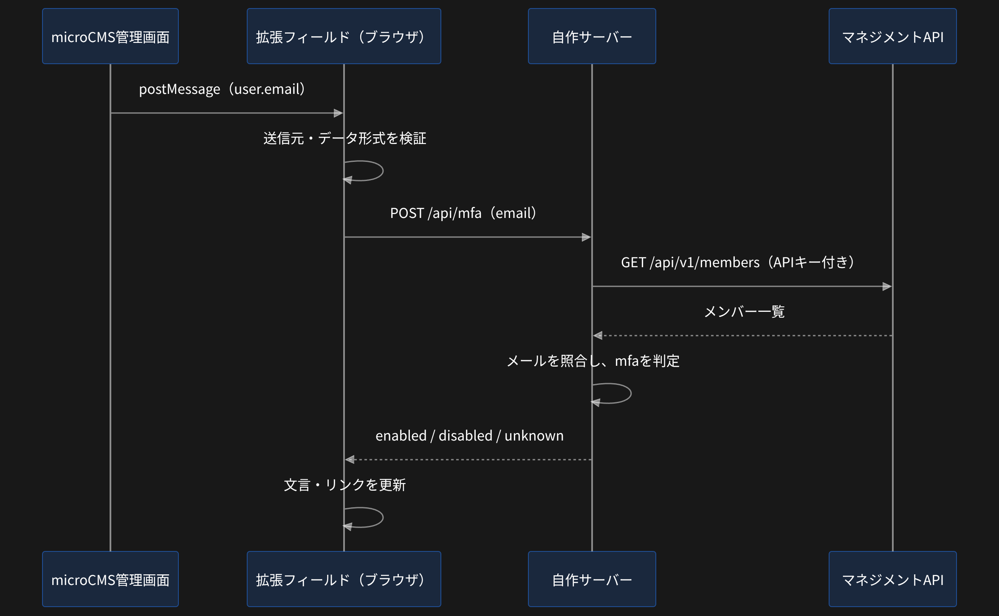
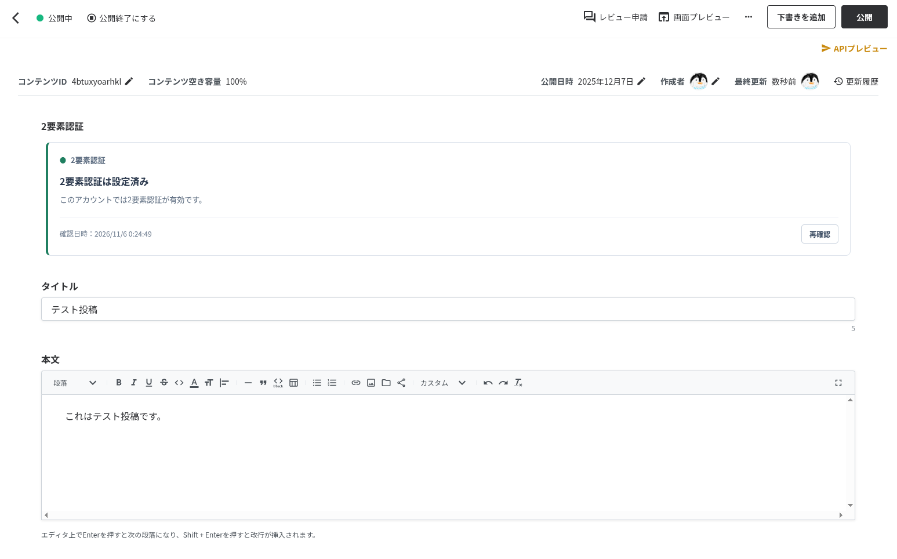
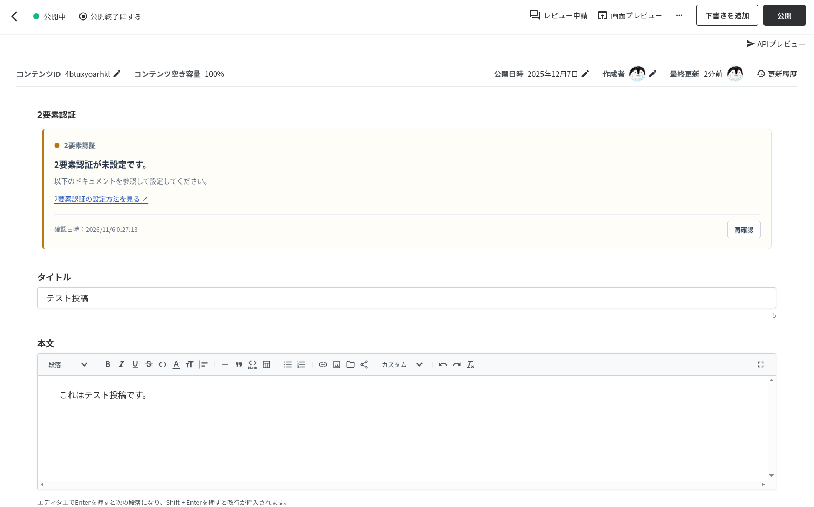

こんにちは。トップ画像は神戸の五色塚古墳です。
住宅街のど真ん中に葺石の古墳が現れるのでビビります。

昨今のAIによるサイバー攻撃の勢いを鑑みると、パスワードに加えて2要素認証の設定がマストになってきそうです。
microCMSでもユーザーごとに2要素認証を設定できますが、未設定ユーザーへの通知などは運用でカバーする必要があります。

今回は拡張フィールドとマネジメントAPIを使って、コンテンツ詳細画面に2要素認証の設定を促す表示を出してみよう、という回です。

## 仕組み

microCMSの拡張フィールドは、iframeを介してフロント側にログインしているユーザーのメールアドレスを渡します。

公式ドキュメントのpostMessage例をそのまま拝借。

```json
{
  id: 'some-id',  // iframe識別子
  action: 'MICROCMS_GET_DEFAULT_DATA',
  message: {
    data: 'iframeでデータを登録しています' // 拡張フィールドの実データ
  },
  user: {
    email: 'example@microcms.co.jp' // ログイン中のユーザーメールアドレス
  },
  context: {
    type: 'new_content', // コンテンツの新規作成時は'new_content'が、編集時には'edit_content'が入る
    endpoint: 'some-api', // コンテンツAPIのエンドポイント名
    content: {
      id: null // コンテンツの新規作成時はnullが、編集時には実際のコンテンツIDが入る
    }
  }
}
```

つまり、拡張フィールドのフロント側では、ログインしているユーザーのメールアドレスを識別できます。

拡張フィールドの詳しい仕組みなどは公式ドキュメントをご覧ください。
[拡張フィールド｜microCMSドキュメント](https://document.microcms.io/manual/field-extension)

さらに、マネジメントAPIのメンバー一覧取得APIを利用すると、対象ユーザーが2要素認証を設定しているかどうかを取得できます。

こちらも公式ドキュメントのレスポンス例を拝借。

```json
{
  "members": [
    {
      "id": "xxxxxxxx-xxxx-xxxx-xxxx-xxxxxxxxxxxx",
      "name": "test-member",
      "email": "test@microcms.co.jp",
      "mfa": true,
      "inviting": false,
      "lastAccessedAt": "2026-01-01T00:00:00.000Z"
    },
    {
    ...
    }
  ],
  "totalCount": 120,
  "token": "xxxxxxxxxxxxxxxxxxxxxxxxxxxxxxxxx"
}
```

`mfa`プロパティが2要素認証の設定有無になります。

というわけで、

- 拡張フィールドのフロント側でログインユーザーのメールアドレスを取得する
- マネジメントAPIで2要素認証の設定有無を照合する
- 設定有無によって表示を出し分ける

上記の流れで、コンテンツ詳細画面で2要素認証の設定を促すことができるわけです。

## 実装

コード全体はあとでリポジトリのURLを乗せますので、キモの部分だけ。
仕様をAIに渡せばフルオートで実装してくれる時代ではあるのですが...

フローはこんな感じ。



以下の公式SDKを使って実装しています。
[GitHub - microcmsio/microcms-field-extension: Libraries for create field extension · GitHub](https://github.com/microcmsio/microcms-field-extension)

まずはmicroCMSから初期メッセージを受け取ります。

```typescript
const cleanup = setupFieldExtension({
  origin,
  height: Math.ceil(document.body.getBoundingClientRect().height),
  width: '100%',
  onDefaultData: event => {
    const data = readInitialMessage(event, window.parent, origin);
    if (data) onInitialData(data);
  },
  onPostSuccess: () => {},
  onPostError: () => {},
});
```

送信元などを検証したうえで、メールアドレスを取り出し。

```typescript
export function readInitialMessage(
  event: IncomingMessage,
  parentWindow: unknown,
  allowedOrigin: string,
): InitialData | null {
  if (
    event.isTrusted !== true ||
    event.source !== parentWindow ||
    event.origin !== allowedOrigin ||
    !isRecord(event.data) ||
    event.data.action !== 'MICROCMS_GET_DEFAULT_DATA'
  ) return null;

  const { id, user } = event.data;
  if (typeof id !== 'string' || !id || id.length > 256) return null;

  return {
    id,
    email: isRecord(user) && isEmail(user.email) ? user.email : null,
  };
}
```

取得したメールアドレスをサーバー側に渡します。

```typescript
if (!context?.email) {
  render('unknown');
  return;
}
render('loading');

const response = await fetch('/api/mfa', {
  method: 'POST',
  headers: { 'Content-Type': 'application/json' },
  body: JSON.stringify({ email: context.email, refresh }),
  signal: requestController.signal,
  cache: 'no-store',
  credentials: 'omit',
  redirect: 'error',
});
```

サーバー側ではマネジメントAPIでユーザー一覧を取得して...

```typescript
const url = new URL(
  `https://${serviceId}.microcms-management.io/api/v1/members`,
);
url.searchParams.set('limit', '100');
if (token) url.searchParams.set('token', token);

const page = await requestPage(url, signal);
```

メールアドレスとユーザーの2要素認証の設定状況を照合。あとは画面を出し分けるだけです。

```typescript
if (!data.members.has(email)) return { status: 'unknown' };

return {
  status: data.members.get(email) ? 'enabled' : 'disabled',
  checkedAt: new Date(data.checkedAt).toISOString(),
};
```

コード全体が気になる方向けに、GitHubにコードを公開しておきます。
[ibulog/microcms-extension-field-2fa-sample: microCMSの拡張フィールドでログインユーザーの2要素認証設定状況を表示するTypeScriptアプリ](https://github.com/ibulog/microcms-extension-field-2fa-sample)

上記のコードをどこかにデプロイし、microCMSの拡張フィールドで利用すれば、動作確認は可能です。

## 動作確認

ちゃんと動くか動作確認してみます。

まずは2要素認証が有効の状態で、コンテンツ詳細画面を開いてみます。



きちんと有効になっている表示が出ました。

2要素認証を無効にして、再度開いてみると...



このように、2要素認証の有効化を促す画面が表示されました。

## おわりに

今回は「ただ表示するだけ」という、ちょっと変わり種の拡張フィールドのユースケースの紹介でした。
この拡張フィールドは、フロント側からmicroCMSにデータを送信しないので、実は拡張フィールドを追加してもコンテンツAPIのレスポンスは変わりません。

なお、今回の拡張フィールドではメンバー一覧を取得しており、取り扱いには少し注意が必要です。
IP制限が可能なインフラを使うとか、そもそもインターネットに公開していない環境で動かすなど、気配りが必要かと思います。

おわり。
